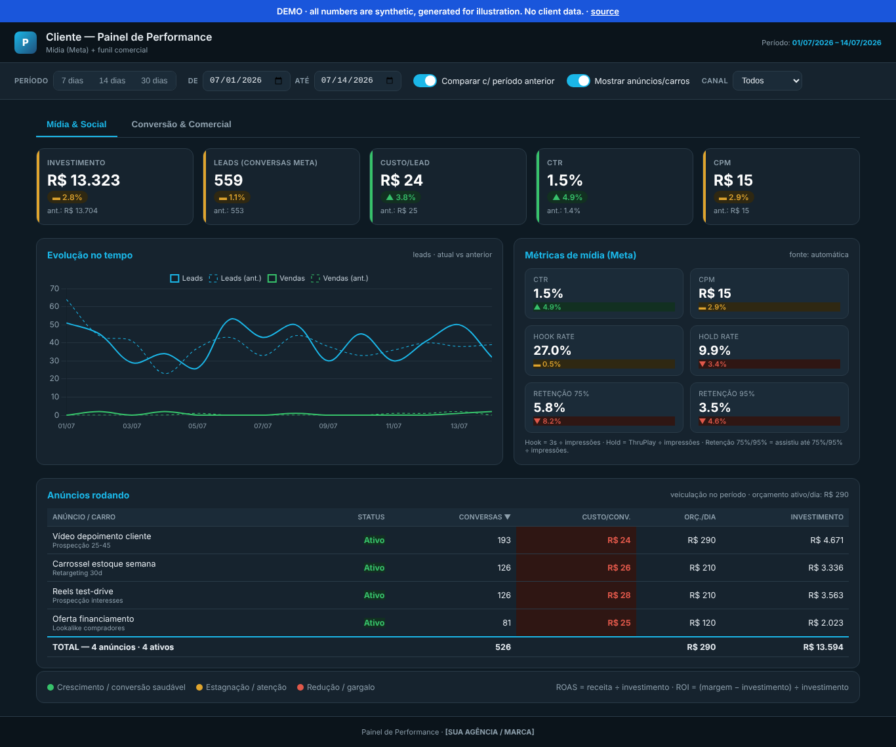
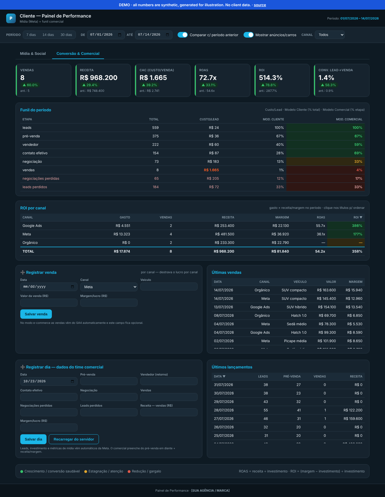

# Multichannel Performance Dashboard

A white-label marketing and sales dashboard for businesses that sell through a sales team (inside sales), fed by **Meta Ads, Google Ads and GA4**, with the sales team entering what the ad platforms cannot see: hand-offs, negotiations, closed deals and margin. Zero hosting cost: Google Sheets + Apps Script as the backend, a single HTML file as the frontend.

**Live demo with synthetic data:** https://alexfiorotti-af.github.io/multichannel-performance-dashboard/

> The interface is in Brazilian Portuguese (it was built for Brazilian clients). This README is in English. All numbers in the demo are randomly generated; no client data is included.

## The problem it solves

Ad platforms report leads and "conversions"; the business cares about **sold units, revenue and margin per channel**. In inside-sales businesses (car dealerships, real estate, clinics) the sale happens on WhatsApp or in the showroom, days later, invisible to the pixel. This dashboard joins both sides on one screen:

- **Media:** spend, leads, cost per lead, CTR, CPM, video hook/hold/retention rates, and every running ad with its cost per conversation.
- **Sales funnel:** lead → pre-sale → salesperson → effective contact → negotiation → sale, with cost per stage and conversion by stage.
- **ROI per channel:** spend × sales × revenue × margin × ROAS × ROI for Meta, Google Ads, organic and referrals.
- **Period comparison:** every KPI against the previous equal-length period.

## Design decisions

- **One source of truth for revenue.** Meta, Google and GA4 each claim the same sale. Revenue is never summed across platforms: `MODO_CONVERSAO` decides where truth comes from: `ecommerce` (GA4 purchase revenue), `inside_sales` (the sales team's entries) or `hibrido`.
- **ROI on margin, not revenue.** ROAS (revenue ÷ spend) flatters high-ticket products; ROI is computed on contribution margin.
- **GA4 is a lens, not a channel.** It explains where traffic came from; spend per channel comes from the ad platforms.
- **No server to maintain.** Apps Script collects Meta (Graph API) and GA4 (Analytics Data API) daily into a Google Sheet and serves it as a JSON endpoint; a Google Ads script exports campaign cost into the same sheet. Tokens live in Script Properties, never in code.

## Structure

| Path | What it is |
|---|---|
| `template/index.html` | The clean dashboard: paste your Apps Script `/exec` URL into `const API` |
| `template/sheet-template.xlsx` | Central sheet model (tabs: Meta, Anuncios, GA4, GoogleAds, Comercial) |
| `apps-script/Code.gs` | Collectors (Meta, ads, GA4), normalised `Vendas` layer, read/write JSON API |
| `google-ads/export_campaigns.js` | Runs inside Google Ads, exports the last 30 days of campaigns to the sheet |
| `docs/` | The demo (GitHub Pages) and screenshots |

## Setup (about 30 minutes)

1. Upload `sheet-template.xlsx` to Google Drive and open it as a Google Sheet.
2. Extensions → Apps Script → paste `Code.gs`.
3. Script Properties: `META_TOKEN`, `META_ACCOUNT_ID`, optionally `GA4_PROPERTY_ID` and `MODO_CONVERSAO`.
4. For GA4: Services (+) → *Analytics Data*. Run `primeiraConfiguracao`, deploy as a Web App, copy the `/exec` URL.
5. For Google Ads: paste `export_campaigns.js` into Google Ads → Scripts, set `SHEET_ID`, authorise and schedule daily.
6. Put the `/exec` URL into `const API` in `template/index.html` and publish it (GitHub Pages, Vercel, anywhere static).

## How it was built

Built for a car dealership client and then generalised into a reusable kit. The code was written with AI; I defined the metrics model (funnel stages, the single source of truth for revenue, ROI on margin), and designed the data flow. Front end: plain HTML/CSS/JS with Chart.js and a CSS-variable design system, no build step.

## License

MIT
